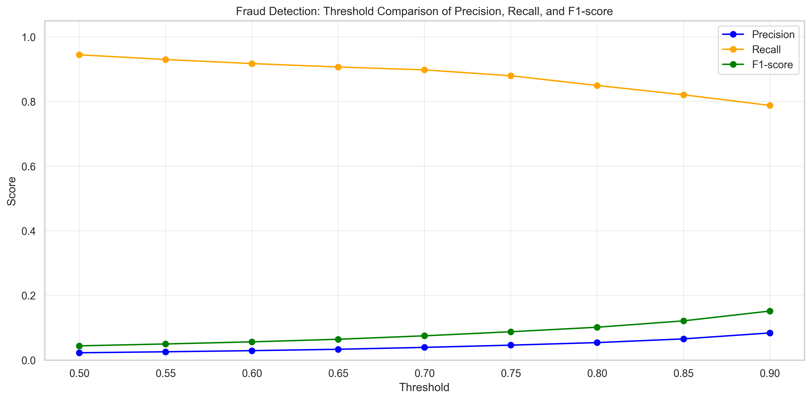

# Fraud Detection Using Machine Learning

A machine learning project that explores the detection of fraudulent transactions using Python and Scikit-learn.

The project began as a tutorial-based implementation and has been extended with model evaluation, classification threshold analysis, data visualization, a FastAPI backend, and an interactive web frontend.

The current implementation uses **Logistic Regression** as its baseline classification model. Further model comparison and evaluation are planned.

## Project Objectives

- Train a machine learning model to classify transactions as legitimate or fraudulent.
- Evaluate model performance using multiple classification metrics.
- Investigate the challenges of imbalanced classification.
- Analyze classification thresholds and their impact on predictions.
- Visualize the trade-off between Precision, Recall, and F1-score.
- Expose model predictions through a REST API.
- Build a web interface for submitting transactions and displaying predictions.
- Compare alternative machine learning models in future iterations.

## Technologies

- Python
- Pandas and NumPy
- Scikit-learn
- Matplotlib
- Joblib
- Jupyter Notebook
- FastAPI
- Uvicorn
- Pydantic
- HTML, CSS, and JavaScript
- Git and GitHub

## Project Structure

```text
fraud_ml_project/
├── backend/
│   └── app.py
├── frontend/
│   ├── index.html
│   ├── style.css
│   └── script.js
├── analysis.ipynb
├── fraud_detection.py
├── fraud_detection_model.pkl
├── threshold_comparison.png
├── .gitignore
└── README.md
```

- `backend/app.py`: FastAPI application that loads the trained model, validates transaction data, and exposes prediction and health-check endpoints.
- `frontend/index.html`: Structure of the FraudLens web interface.
- `frontend/style.css`: Styling and responsive layout of the frontend.
- `frontend/script.js`: Frontend logic for API communication, form validation, and displaying prediction results.
- `analysis.ipynb`: Data analysis, model training, evaluation, and threshold experiments.
- `fraud_detection.py`: Application code from the initial implementation.
- `fraud_detection_model.pkl`: Saved machine learning pipeline used by the API.
- `threshold_comparison.png`: Visualization of evaluation metrics across different classification thresholds.
- `.gitignore`: Files and directories excluded from Git tracking.

The dataset is stored locally and is not included in this repository.

## Initial Tutorial and Project Development

This project initially started as a learning exercise based on the following YouTube tutorial:

**Original tutorial:** [Fraud Detection Using Machine Learning – Full Python Data Science Project](https://www.youtube.com/watch?v=4Od5_z28iIE)

The tutorial provided the initial learning foundation for exploring the dataset, preparing the data, training a classification model, and saving the trained pipeline.

Building on this initial implementation, the project has been extended with additional experiments, evaluation visualizations, API integration, a web interface, and documentation.

The original tutorial is acknowledged as the starting point of the project. The additional analyses and planned improvements are documented separately to distinguish the initial implementation from subsequent development.

**Licensing note:** The original tutorial's code licensing terms have not yet been verified. Public availability on YouTube does not automatically grant permission to redistribute or reuse the code. The original license should be checked before redistributing the original implementation.

## Current Implementation

The current version uses **Logistic Regression** as its baseline model for binary fraud classification.

The model pipeline uses Scikit-learn and handles class imbalance through `class_weight="balanced"`. The saved pipeline is loaded by the FastAPI backend to generate predictions.

### Implemented Features

- Data preprocessing and feature engineering.
- Logistic Regression model training and evaluation.
- Handling of class imbalance.
- Confusion matrix analysis.
- Classification threshold experiments.
- Visualization of Precision, Recall, and F1-score across different thresholds.
- FastAPI backend exposing `/health` and `/predict` endpoints.
- Input validation for transaction data using Pydantic.
- Interactive web frontend built with HTML, CSS, and JavaScript.
- Frontend-to-backend integration using HTTP requests.
- Display of predicted transaction classification and estimated fraud probability.

### Application Architecture

The application follows this flow:

1. The user enters transaction details in the web interface.
2. JavaScript sends the transaction data to the FastAPI `/predict` endpoint.
3. The API validates the input and passes the features to the trained model.
4. The model returns a prediction and an estimated fraud probability.
5. The API returns the result as JSON.
6. The frontend displays the classification and probability to the user.

The `/health` endpoint can be used to check whether the API is running and the model is loaded.

## Model Evaluation

The model is evaluated using the following metrics:

- **Accuracy:** Overall proportion of correct predictions.
- **Precision:** Proportion of predicted fraud cases that are actually fraudulent.
- **Recall:** Proportion of actual fraud cases detected.
- **F1-score:** Harmonic mean of Precision and Recall.

These metrics provide a more informative assessment than Accuracy alone when working with imbalanced data.

### Confusion Matrix

A confusion matrix helps us understand the model's predictions through four categories:

- **True Positives (TP):** Fraudulent transactions correctly identified.
- **True Negatives (TN):** Legitimate transactions correctly identified.
- **False Positives (FP):** Legitimate transactions incorrectly flagged as fraudulent.
- **False Negatives (FN):** Fraudulent transactions incorrectly classified as legitimate.

## Classification Threshold Analysis

We experimented with thresholds from 0.50 to 0.90 to investigate how changing the decision threshold affects the model's predictions.

| Threshold | Precision | Recall | F1-score | False Positives | False Negatives |
|-----------:|----------:|-------:|---------:|----------------:|----------------:|
| 0.50 | 0.0225 | 0.9448 | 0.0439 | 101,241 | 136 |
| 0.70 | 0.0391 | 0.8981 | 0.0750 | 54,325 | 251 |
| 0.80 | 0.0540 | 0.8498 | 0.1015 | 36,697 | 370 |
| 0.90 | 0.0839 | 0.7881 | 0.1516 | 21,210 | 522 |

Among the tested thresholds, 0.90 achieved the highest F1-score. However, increasing the threshold also reduced Recall, meaning that more fraudulent transactions were missed.

The appropriate threshold depends on the balance between missed fraud cases and false alarms. Further validation is needed before selecting a final threshold.

These comparisons are exploratory and use the current test set. A separate validation set should be used for threshold selection in future experiments.

### Threshold Comparison Visualization

The following figure shows how Precision, Recall, and F1-score change as the classification threshold increases.



The visualization highlights the trade-off between detecting fraudulent transactions and reducing false positives.

## Current Model Performance

At the default threshold of 0.50, the model achieved the following results on the current test set:

| Metric | Result |
|--------|-------:|
| Accuracy | 94.69% |
| Precision | 2.25% |
| Recall | 94.48% |
| F1-score | 0.0439 |

The model achieves high Recall but low Precision. This indicates that it detects most fraudulent transactions while also incorrectly flagging many legitimate transactions.

Because the dataset is highly imbalanced, Accuracy alone is not sufficient to evaluate the model's usefulness.

These results are experimental and do not establish that the model is suitable for production use.

## API and Frontend Testing

The current application has been tested locally with the FastAPI backend and web frontend running together.

Two sample transactions were submitted through the interface:

- **Sample 1:** The model classified the transaction as `Fraudulent`, with an estimated fraud probability of approximately 75.53%.
- **Sample 2:** The model classified the transaction as `Legitimate`, with an estimated fraud probability of 0.00%.

These tests confirm that the basic end-to-end prediction flow works for the tested inputs. They do not measure generalization performance or prove that the predictions are correct for real-world transactions.

## Running the Application Locally

### 1. Install Dependencies

Activate your virtual environment and install the required packages.

```bash
python -m pip install pandas numpy scikit-learn matplotlib joblib fastapi uvicorn
```

### 2. Start the FastAPI Backend

Run the following command from the project root:

```bash
python -m uvicorn backend.app:app --reload
```

The API will be available at:

`http://127.0.0.1:8000`

Interactive API documentation is available at:

`http://127.0.0.1:8000/docs`

The health-check endpoint is:

`http://127.0.0.1:8000/health`

### 3. Start the Frontend

Open `frontend/index.html` in Visual Studio Code and run it using the Live Server extension.

The frontend communicates with the local FastAPI backend at `http://127.0.0.1:8000`.

Keep the backend running while using the frontend.

## Limitations

- Logistic Regression is currently the only implemented model in the application.
- The existing threshold analysis is exploratory and uses the current test set.
- The model's estimated probabilities should not be interpreted as guarantees of fraud or legitimacy.
- The model has not been validated for real-world financial decisions.
- Further testing is needed to assess performance on unseen transactions and select an appropriate decision threshold.

## Future Work

- Compare Logistic Regression with Random Forest and Gradient Boosting.
- Evaluate candidate models using a consistent data split and appropriate classification metrics.
- Use a separate validation set for model selection and threshold tuning.
- Evaluate Precision, Recall, F1-score, and Precision-Recall AUC (PR-AUC).
- Investigate approaches to reduce false positives without missing too many fraudulent transactions.
- Select the best-performing model and integrate it into the API.
- Add automated tests for the API and frontend integration.
- Add application screenshots and further usage examples.
- Improve project documentation and reproducibility.

## Learning Outcomes

This project provides practical experience with:

- Machine learning classification pipelines.
- Model evaluation on imbalanced datasets.
- Confusion matrices and classification metrics.
- Classification threshold experimentation.
- Saving and reusing trained models.
- Building REST APIs with FastAPI.
- Validating API inputs with Pydantic.
- Connecting a JavaScript frontend to a machine learning API.
- Version control and project documentation with Git and GitHub.

## Disclaimer

This project is intended for educational purposes. Its performance depends on the dataset and evaluation methodology, and it has not been validated for real-world financial decisions. Predictions should be treated as model estimates rather than definitive determinations of fraud.
